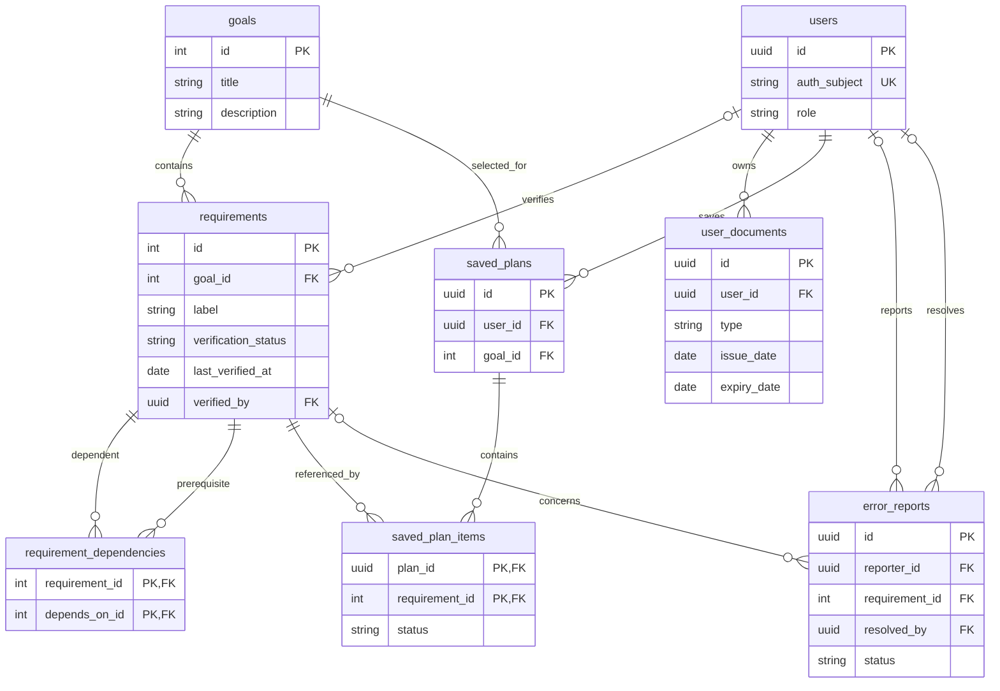

# Phase 2 database design draft

**Issue:** [#33](https://github.com/UIC-CCS-WEB-DEVELOPMENT-2026-2027/requisito/issues/33)

**Status:** Draft complete; teammate review waived at the project owner's request. No backend, migrations, authentication,
database connection, or document upload is implemented by this draft.

## Pitch

Week 2 uses static arrays to demonstrate a First Job checklist. Phase 2 proposes
a relational database, such as PostgreSQL, accessed through an authenticated
server API. React would keep reusable cards and replace the static helpers with
an API-backed data layer. The database and provider remain team decisions.

Phase 2 adds:

- **Login:** identify users through a managed authentication provider and limit
  access to each user's own plans and document metadata.
- **Saved plans:** save a selected goal and requirement completion between visits.
- **Document tracker:** record document types and issue/expiry dates, calculate
  status, and let users edit or delete their own entries.
- **Admin console:** maintain goals, requirements, dependencies, and verified
  sources; review error reports and record resolutions.

## Proposed architecture

React pages -> authenticated server API -> relational database.

The server validates inputs, checks ownership and admin permissions, and performs
database writes. Database credentials and administrative secrets stay on the
server. Authentication establishes identity; it does not replace authorization.
The initial tracker stores metadata only, without identity numbers or scanned
documents. File storage is outside this proposal.

## Tables and key fields

IDs identify application records, not government-issued numbers. Catalog IDs
use integers to align with the Week 2 contract; private records use UUIDs.
Dates use DATE; timestamps use timezone-aware timestamps stored in UTC.

### goals

| Field | Type / constraint | Purpose |
| --- | --- | --- |
| id | integer, primary key | Stable goal identifier |
| title | text, required | Goal name |
| description | text, required | Goal summary |
| archived_at | timestamp, nullable | Retire a goal without breaking saved plans |
| created_at, updated_at | timestamp, required | Maintenance history |

One goal has many requirements and saved plans. Derive `stepsCount` by counting
its active requirements instead of storing a second count that can drift.

### requirements

| Field | Type / constraint | Purpose |
| --- | --- | --- |
| id | integer, primary key | Stable requirement identifier |
| goal_id | integer, FK -> goals.id, required | Owning goal |
| label, notes | text, required | Instructions and context |
| copies | integer, nullable; positive when set | Verified quantity; null means unknown |
| source_url | text, nullable | Reviewed official source |
| last_verified_at | date, nullable | Actual date a human checked the source |
| verification_status | unverified / verified / conflicting | Catalog content quality |
| verified_by | UUID, nullable FK -> users.id | Reviewer identity |
| display_order | integer, required | Stable ordering among independent steps |
| archived_at | timestamp, nullable | Retire content while retaining references |
| created_at, updated_at | timestamp, required | Maintenance history |

Verified content requires a source, verification date, and reviewer. Publication
must not turn the Week 2 sample date into a real verification date. Requirements
may be completed separately by many users; completion belongs in saved_plan_items.

### requirement_dependencies

| Field | Type / constraint | Purpose |
| --- | --- | --- |
| requirement_id | integer, FK -> requirements.id | Step that needs a prerequisite |
| depends_on_id | integer, FK -> requirements.id | Prerequisite step |

Composite primary key: `(requirement_id, depends_on_id)`. Reject self-dependencies.
An edge A -> B means B must precede A. Both requirements must belong to the same
goal; the server checks that invariant and rejects cycles within a transaction.
This is a directed many-to-many relationship. Initial edges mean **all** listed
prerequisites are needed. Conditional rules and “any one of” groups require a
later schema extension and are not represented by this table alone.

### users

| Field | Type / constraint | Purpose |
| --- | --- | --- |
| id | UUID, primary key | Internal account identifier |
| auth_subject | text, unique, required | Managed provider's stable identity |
| display_name | text, nullable | Optional display name |
| role | user / admin; default user | Server-enforced authorization role |
| created_at, updated_at | timestamp, required | Account lifecycle |

Passwords are managed by the authentication provider and are not stored here.
Clients cannot promote themselves to admin. Email is omitted unless a later
feature demonstrates a need to store it outside the authentication provider.

### user_documents

| Field | Type / constraint | Purpose |
| --- | --- | --- |
| id | UUID, primary key | Tracker entry identifier |
| user_id | UUID, FK -> users.id, required | Owner |
| type | text, required | Document type, not an identifying number |
| issue_date | date, nullable | User-supplied issue date |
| expiry_date | date, nullable | Expiry date when applicable |
| created_at, updated_at | timestamp, required | Edit history |

One user has many entries. Allow renewals and multiple records of a type; do not
make `(user_id, type)` unique. When both dates exist, expiry cannot precede issue.
Do not store a status that becomes stale: derive expired, expiring within a
proposed 30-day window, valid, or unknown from dates. The team must agree on the
window and treatment of non-expiring documents before implementation. These
additional states need a Phase 2 UI contract update; never label unknown or
expired records as valid to fit the Week 2 sample enum.

### error_reports

| Field | Type / constraint | Purpose |
| --- | --- | --- |
| id | UUID, primary key | Report identifier |
| reporter_id | UUID, nullable FK -> users.id | Reporter; nullable after account deletion |
| requirement_id | integer, nullable FK -> requirements.id | Affected requirement, if any |
| description | text, required | Incorrect content or app behavior |
| status | open / in_review / resolved / dismissed | Triage state |
| resolution | text, nullable | Admin explanation |
| resolved_by | UUID, nullable FK -> users.id | Admin who closed the report |
| created_at, updated_at, resolved_at | timestamps; resolved_at nullable | Triage history |

Allow general app reports without a requirement. In the initial proposal,
submission requires login. Users see only their own reports; admins can triage
all reports. Warn users not to include personal IDs or document images.

### saved_plans (supporting table)

| Field | Type / constraint | Purpose |
| --- | --- | --- |
| id | UUID, primary key | Saved plan identifier |
| user_id | UUID, FK -> users.id, required | Owner |
| goal_id | integer, FK -> goals.id, required | Selected goal |
| created_at, updated_at | timestamp, required | Save history |

One user can save multiple plans. Creating a plan and its items is atomic.

### saved_plan_items (supporting table)

| Field | Type / constraint | Purpose |
| --- | --- | --- |
| plan_id | UUID, FK -> saved_plans.id | Owning plan |
| requirement_id | integer, FK -> requirements.id | Referenced catalog requirement |
| status | unverified / done; default unverified | Per-plan completion using the Week 2 enum |
| completed_at | timestamp, nullable | Completion time; set only for done |

Composite primary key: `(plan_id, requirement_id)`. The server checks that each
requirement belongs to the plan's goal. Here `unverified` means not completed,
not the catalog's source quality. The UI must distinguish these concepts.
Plans retain their item membership when catalog entries are added or archived;
catalog text edits remain live. Immutable plan snapshots are a later decision.

## Entity diagram

## Relationships, integrity, and access

- Index foreign keys, especially requirements.goal_id, user_documents.user_id,
  saved_plans.user_id, saved_plan_items.requirement_id, and both dependency ends.
  Index reports by status and creation time for admin triage.
- Catalog content is publicly readable through the server; only admins can edit.
  Private rows are scoped to the authenticated owner on every read and write.
  Plan-item authorization follows the parent plan. Use database row policies
  where supported as an additional ownership check.
- Archive referenced goals and requirements instead of deleting them. Foreign
  keys restrict catalog deletion while references exist.
- Deleting a plan cascades to its items. Account deletion removes private plans,
  items, and document metadata. Set report authors/resolvers and catalog reviewer
  references to null; define report retention and removal of personal free text
  before launch. Auth-provider account deletion must be coordinated separately.
- Store no real government ID numbers, scanned IDs, or sample credentials.
  Validate dates, source URLs, text lengths, and status transitions server-side.
  Admin writes must log actor, time, and changed fields; the audit storage design
  remains a pre-launch decision.

## Mapping from Week 2

The current [data contract](data-contract.md) remains unchanged. A future adapter
would map `goal_id` -> `goalId`, `source_url` -> `sourceUrl`,
`last_verified_at` -> `lastVerified`, and `issue_date` -> `issueDate`.
It would calculate stepsCount and scope summary counts to the signed-in user's
plans and documents. The catalog verification status is not a user's done status.

Database UUIDs for private documents and nullable dates cannot fit every Week 2
type. Before API integration, version the UI contract to support private string
IDs, unknown quantities/dates, verification state, and additional document
statuses. Do not invent dates, quantities, or verified sources to satisfy the
static fixtures. Existing sample data must stay unverified until human review.

## Review checklist and decisions

- Teammate review of relationships, dependency direction, and the ER diagram was waived at the project owner's request; no teammate review is recorded.
- [ ] Team agrees on authentication/database providers and ownership policies.
- [ ] Team agrees on expiry rules, plan update behavior, and Phase 2 UI types.
- [ ] QA confirms source verification and tests private-record access boundaries.
- [ ] Team agrees on account deletion, report retention, and admin audit storage.

The documentation draft is complete with teammate review waived. This document is a pitch, not a reviewed production schema. The implementation decisions above remain open for Phase 2.
